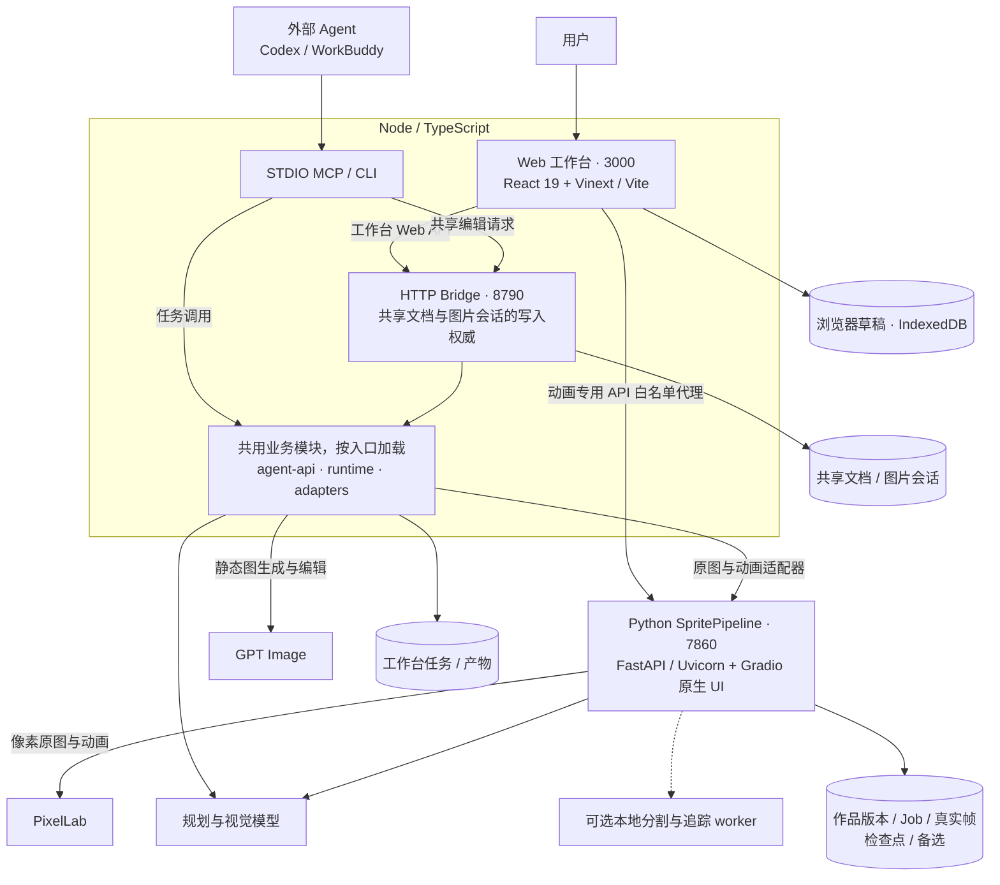

# 系统架构

本文描述 `paper-vbyc` 分支的当前实现，核对基准为 `a140d1c7680b`，更新于 2026-11-15。实施历史与验收记录见[论文分支执行计划](论文分支执行计划.md)和[工程问题清单](问题清单/README.md)。

Forge 是本地优先的资产制作工作台：Node 负责接入、任务适配、共享编辑与交付，Python SpritePipeline 负责原图服务、动画生产、检查点与备选。当前分支保留角色与交互物序列帧、物品图片、局部调整、交互物编辑和 Godot 交付；地图拼接、场景组装、场景协作、地图分层及可站面原型保留在 `new-arch`，不属于本分支运行架构。

Codex、WorkBuddy 等外部客户端是主 Agent。Web 提供编辑、预览、检查和导出；动画服务中的多专家规划器只处理明确的制作任务及其调用预算。实验策略通过独立工具运行，不进入产品生成界面。

## 1. 服务拓扑与调用边界

图中端口是本地默认值，箭头表示调用或持久化；虚线表示可选辅助处理。`agent-api.mjs`、`runtime.mjs` 和适配器是共用代码模块，不是额外的常驻服务。MCP 随客户端启动，CLI 按次运行。

`npm run dev` 由 [scripts/dev.mjs](../scripts/dev.mjs) 启动或复用三个服务：

| 服务 | 默认地址 | 职责与实现 |
| --- | --- | --- |
| Web | `http://localhost:3000` | React 工作台、Vinext/Vite 与服务端 API 路由；主动画界面位于 `components/sprite-generator/` |
| HTTP Bridge | `http://127.0.0.1:8790` | `scripts/workbench-http.mjs`；任务 API、共享文档、图片会话、资产与交付接口 |
| SpritePipeline | `http://127.0.0.1:7860` | FastAPI/Uvicorn；开放动作、原图、原生 Job、像素编辑及导出接口；Gradio UI 与 API 共用服务实例 |

调用分为三条路径：

1. 工作台能力调用：MCP/CLI 和 Bridge 复用 `agent-api`、`runtime` 与适配器；runtime 创建任务并调度清单声明的能力。
2. 动画原生工作区：Web 经 [open-motion 路由](../app/api/workbench/open-motion/route.ts)的路径、方法与参数白名单代理访问 Python；MCP/CLI 的 sprite adapter 也访问同一服务。动画操作不必全部经过 Bridge 或新建一份 runtime task。
3. 共享编辑：MCP/CLI 的文档与图片会话请求转发到同一个 Bridge，包括可能刷新候选状态的读取。Bridge 不可用时报告失败，不回退到客户端进程直接写共享文件；同一数据目录只支持一个写入权威 Bridge。

`npm run dev:interactable` 仍启动 Web 与 Bridge，但不启动 SpritePipeline。配置非默认 Bridge 地址时总控不接管该服务；`SPRITE_PIPELINE_API_URL` 指向非默认或非回环地址时，SpritePipeline 由外部维护。托管 Web 页面不会自动获得开发者电脑上的本地服务，远程使用需要单独部署经过认证与访问控制的服务。详见[使用与操作手册](operations-manual.md)。

## 2. 模块分层与能力来源

| 层 | 主要位置 | 职责 |
| --- | --- | --- |
| Agent 指导 | MCP discovery、`.agents/skills/`、`workbench/guides/` | 能力选择、主题路由、制作与工程交接规则 |
| 能力与配置清单 | [workbench/manifest.json](../workbench/manifest.json) | 能力 ID、输入 schema、连接器、产物、页面路由、工作流与数据目录 |
| 接入层 | `scripts/workbench-mcp.mjs`、`scripts/workbench.mjs`、`scripts/workbench-http.mjs`、`app/api/workbench/` | STDIO MCP、CLI、HTTP 与 Web 代理 |
| 共用业务层 | [agent-api.mjs](../lib/workbench/agent-api.mjs)、[runtime.mjs](../lib/workbench/runtime.mjs)、`lib/workbench/adapters/` | Agent 操作分派、任务校验与持久化、适配器执行和异步恢复 |
| Web 编辑层 | `app/`、`components/`、`features/` | 页面、图形交互、播放、检查、草稿和共享编辑同步 |
| 动画生产层 | `Tools/SpritePipeline/sprite_pipeline/`，开放动作位于 `collaboration/` | 对象、规划、生成、技术 QA、复核、检查点、修正与导出 |
| 共享编辑层 | `lib/workbench/editor-documents.mjs`、`image-edits.mjs`、`features/editor-documents/` | 文档命令、版本、请求身份、图片会话、媒体与恢复 |
| 资产与交付层 | `asset-catalog.mjs`、`asset-packages.mjs`、`game-export.mjs`、`features/godot-export/` | 资产发现、导入、打包、安装计划、备份与交付证据 |

manifest 是工作台级能力目录；各入口消费同一套能力 ID、输入 schema、连接器和产物声明。当前注册四项能力，适配器由 [adapters/index.mjs](../lib/workbench/adapters/index.mjs) 绑定：

| capability ID | adapter | 主要职责 |
| --- | --- | --- |
| `reference-art` | `reference-art` | PixelLab 角色与 128 像素物品原图、角色参考导入及对象移送 |
| `sprite-generator` | `sprite-pipeline` | 角色与交互物开放动作、检查、修改与导出 |
| `image-assets` | `image-assets` | GPT Image 透明物品、图片生成式编辑与本地图片处理 |
| `interactable-editor` | `interactable-editor` | 项目校验与 Godot 交互物资源包导出 |

共享文档、图片会话、资产与交付还有独立的类型化操作合同，不应把它们都理解为四项能力的 `run` 请求。工具操作以对应的 `*-contract.mjs`、manifest 登记和实际 MCP discovery 为准；图片工具覆盖目标发现、选区解析、部件与属性计划、候选执行、独立复核和采用。

交互物项目字段以 `features/interactable-editor/contract.mjs` 为编辑源，`npm run schema:interactable` 同步到 manifest。修改这类合同后需要核对生成差异与相关测试。扩展能力时，分别维护适配器、清单和相关操作合同，避免在每个接入端另写一套规则。

## 3. 身份、持久化与任务生命周期

核心生产记录使用文件系统持久化，浏览器草稿保存在 IndexedDB。下表为 `npm run dev` 的默认布局；Node 路径来自 manifest，Python 路径由启动器与环境配置决定。

| 状态或身份 | 含义 | 默认位置 |
| --- | --- | --- |
| runtime Task / `taskId` | 一次工作台能力调用、适配器回执与结果 | `work/tasks/<task-id>.json`，产物在 `outputs/<task-id>/` |
| 动画 Work / `workId` + revision | 原始需求、参考快照、规划与作品版本 | `work/sprite-pipeline/open-motion/` |
| 原生 Job / `jobId` | 生成执行、候选、真实帧、技术 QA、复核与检查点 | `work/sprite-pipeline/jobs/` |
| 交互物 Document / documentId + revision | 已提交的共享工程及不可变历史 | `work/editor-documents/`，由 Bridge 管理 |
| 图片 Session / editId + revision | 源图、区域、配方、候选、计划、复核与采用记录 | `work/image-edits/`，由 Bridge 管理 |
| 浏览器 Draft | 尚未提交的本地编辑与工作区恢复数据 | IndexedDB `workbench-production-v1` |
| 导入、回收站与交付记录 | 素材包收件、资产可见性、安装计划与证据 | `work/imported-assets/`、`work/asset-package-imports/`、`work/asset-trash/`、`work/game-exports/` |

启动器默认将 `SPRITE_PIPELINE_DATA_DIR` 设为 `work/sprite-pipeline`，将 `SPRITE_PIPELINE_EXPORTS_DIR` 设为 `outputs/sprite-pipeline`。独立启动 Python 时，`HarnessSettings` 默认使用操作系统用户数据目录；显式 root 或 `SPRITE_PIPELINE_HOME` 使用兼容的 portable 布局。因此不能把 Python 所有安装方式的作业都假定在仓库内。

这些身份各自表示不同层次的状态。runtime task 完成不代表动画已采用或导出；图片候选保存不代表宿主采用；浏览器草稿不代表共享文档版本；模型复核通过不代表引擎验证。资产目录保留来源及版本，将这些身份连接起来。

runtime 的主要状态为：

- `prepared`：输入已校验并持久化，尚未执行。
- `running`：适配器或原上游异步任务仍在处理。
- `awaiting_configuration`：缺少必要配置。
- `attention_required`：需要检查、配置后继续或恢复原作业。
- `completed`：本次操作成功，声明的产物已校验和记录。
- `failed`：本次操作失败，保留可报告的错误与证据。

`prepareTask` 不执行制作；`runConnector` 先保存任务身份再调用适配器；查询通过 refresh 更新同一上游任务，不重新提交生成。异步后台执行还保留租约与恢复信息，未知提交不自动重发。runtime 只接纳该任务输出目录内的声明产物。

## 4. 动画生产与检查点

该图展示主要生产与交付关系，具体检查、修正和采用是显式操作，不由一条视觉意见自动触发。交互物还支持单独确认状态帧；状态帧与整段过渡有各自的采用条件。

### 4.1 原图与统一对象身份

`reference-art` 通过 Node 适配器访问 Python 原图服务，共用受保护的 PixelLab Key。角色原图支持 64/128 像素，物品原图固定为 128×128；异步 Pixflux 作业 ID 保存在 runtime task。完成后核验透明 PNG、尺寸和产物身份。

`transfer` 使用已完成源任务，不生成动画。角色生成或导入图移送为角色对象；已完成的 128 像素 PixelLab 物品生成任务经 `prop_reference.py` 核验注册来源、真实文件、尺寸及哈希后，移送为 `object_type=interactable` 的对象。通用入口已接通这条路径；它不接受任意上传物品，也不把 GPT Image 大尺寸物品图直接作为动画参考。详见[角色原图](reference-art.md)。

`object_identity.py` 使 TaskSpec、GenerationRequest 与预设共用 `object_id` / `object_type`，类型为 `character` 或 `interactable`。`presets.py` 兼容旧角色目录并拒绝身份冲突；交互物预设不带 facing/weapon_hand。库存同时保留 objects 与兼容的 characters/actions 接口。

历史 character_id-only 输入保留原序列化与冻结哈希，`OpenWork.character` / `JobRecord.character` 容器名仍可承载两类快照。交互物走开放动作对象绑定；旧原生角色/动作和固定攻击流程继续保留兼容。

### 4.2 规划与异步执行

`collaboration/contracts.py` 定义 TaskSpec、PlanProposal、PlanBinding、段级合同与回执；`workspace.py` 保存原始需求、专家质询、参考与版本，`execution.py` 复用原生 Job、提供方提交与帧存储。规划和绘图分别在外部调用前保存意图，锁阻止并发重发；模糊回执需沿原请求恢复或人工核对。GET 不发起新的付费请求。

角色与交互物使用同一流程，按对象类型提供不同合同与复核维度。交互物合同区分起终状态、固定内容、运动部件与轨迹；描述和参考图差异按影响分类，规划前查询可用绘图额度并校验候选数、帧数和预计用量。`prop_measurements.py` 的固定区、铰接半径测量与模型通过意见冲突时保留证据并转入裁决，不用测量代替所有运动判断。

规划策略、格式、模型与输入随 Work 和 Job 冻结。当前规划路径用 `planning_draft.py` 分开策略草案和最终执行说明，`planning_budget.py` 预留专家额度，`executable_brief.py` 校验实际 `stage.prompt`；最终绘图说明最多 1000 字符，不通过额外付费压缩、截断或自动重试来补救。历史协议继续按其冻结版本读取。

### 4.3 复核、状态链与末帧条件

`checkpoints.py` 管理分段证据、模型复核、裁决与锁定快照。片段的 `complete → reviewing → awaiting_review → accepted/rejected` 与上游提交状态分开。接受请求带证据令牌并幂等，只有 accepted 的真实末帧可进入下一段；最终组装读取已确认快照。

`visual_review.py`、`production_review.py` 与独立专家保存实际图片输入、摘要和回执，按冻结协议执行基础检查、独立外观/运动意见及必要的争议复核。`visibility_review.py` 保留遮挡、投影、直接矛盾和未决冲突；技术硬门禁、视觉意见与人工裁决保持独立。帧改变使旧报告过期，视觉通过不自动生成、修复或采用。详见[视觉专家与争议复核](sprite-review-evaluation.md)。

交互物的 `state_chain.py` 从冻结方案与确认快照导出 A→B→C 状态链：每段一次过渡，确认的真实帧成为具名状态图。单独确认状态帧与接受过渡分别留存；选定截尾帧后，预览、状态图与后段输入使用同一真实像素。最终停留帧不充当新状态来源。

`targets.py` 支持同尺寸外部 B 图作为指定段的可选末帧条件，冻结图像并用 `target_set_sha256` 检查目标集合变化；旧请求省略摘要仍保持兼容。目标缺失、损坏或版本过期时停止。外部 B 图是生成条件，后段接续仍取已生成并接受的真实末帧。

## 5. 图片与动画修正

### 5.1 静态图片生成与处理

`image-assets` 嵌入交互物页面，当前默认提供方由 manifest 声明为 GPT Image 2.6 / `gpt-image-2.6-sunburst`。适配器保存原始响应、规范化 PNG、尺寸、实际 Alpha 和 SHA-256；生成与采用分开，采用时重读真实产物并核对来源。PixelLab 物品原图属于上一节的 `reference-art` 路径。

`provider-usage.json` 保存可取得的 token、请求身份、耗时和返回质量等白名单证据；缺失计数及实际账单金额保持未知。`image-assets-processing.mjs` 是生成结果与本地 `process-image` 共用的确定性处理器，不联网、不缩放或覆盖输入。原始返回、派生 PNG 和 processing-report 分别保留。

服务配置由 `image-generation-settings.mjs`、`image-settings-store.mjs` 与平台凭据模块管理，尺寸规划在 `adapters/image-generation-size.mjs`。图片任务完成只说明操作和产物校验成功，不推导视觉质量或实际费用结论。

### 5.2 图片会话与像素保护

[image-edits.mjs](../lib/workbench/image-edits.mjs) 将目标发现、选区、计划、候选、复核与采用组织为持久会话。目标来源由 `image-edit-targets.mjs` 分派到交互物静态槽、独立图片任务和 `motion-frame`；浏览器未提交草稿不作为目标，交互物动画槽不当作静态图片改写。

源 PNG/JPEG/WebP 的文件 `sha256` 与规范解码后 sRGB/RGBA8 的 `rgbaSha256` 分开记录。权威像素来自服务端原图，Canvas、预览和蒙版不替代它。源版本、源图哈希、会话 revision、基准 candidateVersion、目标槽指纹与 commandId 共同约束提交；相同命令恢复原记录，不用新身份重发未知提交。

确定性工具包括替色、色表映射、简单保明暗映射、擦除、填充、平移、像素补丁、Alpha 清理和区域恢复。`features/image-edit/core.mjs` 复用 SpritePipeline 分发的 DOM-free JavaScript 像素核心，不需要 Python 服务或模型调用。`restore-region` 从同源会话恢复区域；`candidateVersion=source` 将原图恢复为新版本，不回滚整个宿主工程。

显式 `ai-edit` 在执行前冻结原尺寸基准、硬边蒙版、描述与参考字节；运行时任务身份先于模型提交持久化，断连或重启后查询原任务。服务端本地合成保护区并在编码后验证区域外 RGBA。启用 `preserveAlpha` 时复制基准图全部 Alpha、跳过清理并独立核验；这不保证选区内生成质量。`recompose-ai` 可重用已有原始返回重新合成，不新增生成调用。详见[图片局部编辑](image-editing.md)。

工作区同时核验编码字节与 RGBA 哈希。已保存候选直接用于预览；未保存笔划的异步编码受 controller、显示模式和版本约束，避免旧回调覆盖新画面。宿主持久保存后才更新采用基线。

### 5.3 动画帧备选与采用

`motion-frame` 精确绑定 Work、revision、候选、段和帧号；选区转换为 `FrameEditRegion`，携带原帧哈希。Node 在图片会话内保存确定性候选，经 `image-edit-target-motion.mjs` 调用 Python 的 `local-frame-edits`。当前 128 像素动画帧不满足 GPT Image 的尺寸门槛，动画上的受限生成修正走 PixelLab 外观编辑与区域保护。

`local_frame_edits.py` 在作品锁内重读来源、检查令牌和逐帧授权，拒绝锁定状态图、接续边界与停留帧，验证范围外像素后原子发布完整播放备选。全段/完整候选的精确替色或色表映射共用该入口，明确跳过锁定帧。保存像素候选、保存完整播放备选和实际采用是三个不同步骤。

生成式选帧修改由 `adjustments.py` 冻结来源、范围、用户原话、建议、模型和独立预算；`adjustment_review.py` 分开判断目标达成与其他内容保持。显式二值区域由 `adjustment_regions.py` 校验并在本地合成保护，原始模型返回另存。范围不从结构观察自动推断或扩张，单独保留明确缺陷、审美偏好和证据不足的判断。

`adjustment_attempts.py` 按重叠真实帧计算已提交绘图次数，与费用账本分开；未发生绘图的理解失败保留规划费用但不占绘图尝试。`adjustment_delivery.py` 在明确采用后更新可编辑的未锁定段，或为完整候选派生新版本；保留原帧、未选中帧和历史证据，跨段替换更新对应实际帧与摘要。`adjustment_import.py` 只关联来源一致且已完成的隔离备选，不调用提供方或自动采用。

段内修复 `repairs.py` 保留原始目录，以 `active_frames` 和映射记录替换并使旧复核过期；整段重画也不能覆盖已锁定边界。生成工具记录选择级别、调用与用量。详见[选帧修改](motion-adjustments.md)。

### 5.4 共用模型配置与独立复核

模型配置统一已接入。Python `model_config.py` 在 `open_motion_models.json` 管理默认配置与 appearance、motion、strategy、coordinator、reviewer、structure 角色；任务冻结实际模型与端点。Node 的 `motion-vision-profile.mjs` 读取同一配置，或读取显式连接服务的公开设置，将 appearance 用于图片部件定位、reviewer 用于独立候选复核。

`motion-vision-store.mjs` 通过 Python 已有的 OS 凭据保护读取本机密钥，秘密只经子进程管道传递，不进入 argv、任务或日志；显式环境凭据与旧图片凭据保留兼容路径。配置变化不改写已冻结的请求。

部件上下文与属性计划先保存精确基准、最大授权区域、参考顺序与成功标准，再显式请求建议或执行候选；一个计划只允许一个候选。独立复核先看中立的基准/候选视图，失败或不确定后的原始返回与蒙版诊断另存证据及调用。结构或模型建议不自动变成编辑授权，也不自动采用。

## 6. 交互物共享文档与状态写回

[editor-documents.mjs](../lib/workbench/editor-documents.mjs) 在 Bridge 管理 `kind=interactable` 文档。提交要求 `expectedRevision` 和 `commandId`：旧版本被拒绝，相同编号不同内容被拒绝，重复请求返回原结果；批量类型化命令全成或全不成。不可变版本先落盘，再原子发布当前版本；恢复产生新 revision。媒体按 SHA-256 引用复用并核验完整性，旧内嵌历史仍可读。

`document-kinds.mjs` 登记实现，`interactable-documents.mjs`、`interactable-document-commands.mjs` 和 `interactable-document-assets.mjs` 分别负责模型、命令与资产。公共合同维护版本、媒体与身份边界；`portableProject` 位于 `features/interactable-editor/portable-project.ts`。

`state_assets.py` 将确认状态图和已接受过渡纳入资产目录；`import-motion-asset` 经共享文档类型化命令写入指定切换槽或序列条目。`interactable-motion-import.mjs` 保留作品、素材版本、检查点令牌与帧哈希，核验来源后写入静态状态图或非循环过渡片段，不改变其他消费者。单独确认的状态图可按自身条件导入，过渡必须已接受；末尾停留帧按真实播放映射处理。

前端复用现有资产选择入口，不增加独立的状态写回页面。`?document=<id>` 打开共享工程；繁忙、有本地修改、离线或版本冲突时保留草稿。`contentHash` 始终表示已存储内容，草稿不冒充服务端版本。

交互物编辑器保留 inspect、toggle、pickup、sequence 四类行为和 proximity_press、pointer_click、automatic_enter、external_request 四类触发。生成与修正发生在序列帧工具；交接后配置行为、碰撞、范围、文本与音效。`simulation-replay.mjs` 提供有界事件模拟与期望检查，不证明 Godot 物理、真实音频或存档行为。导出仍走 `interactable-editor` 的 `export-godot`，不要求本机安装 Godot，也不调用生成 API。详见[交互物](interactable-editor.md)与[内部素材导入](internal-imports.md)。

## 7. 资产目录与 Godot 交付

`asset-catalog.mjs` 按来源身份合并任务产物、原生候选、确认状态/过渡与已导入素材，保留来源版本和创建时间。执行历史归档与资产可见性分离；历史查询先过滤再按快照分页。浏览器草稿不自动收录，资产清单只描述作品，下载真实文件或素材包才完成文件交付。

`asset-packages.mjs` 负责源包检查与导入；资产库可直接提供图片、动画和完整项目给交互物编辑器，无需下载再上传，也不创建新的生成任务。`asset-trash.mjs` 以独立索引、跨进程目录锁与原子替换管理稳定 ID、别名和摘要；回收站改变可见性，不删除源文件，来源离线时仍可恢复摘要。MCP 资产工具保持只读查询与下载边界，Web 管理操作经相应接口执行。

Sprite 导出提供 PNG 与单动作 Godot SpriteFrames 包，交互物导出提供 Godot 资源包。[features/godot-export](../features/godot-export) 统一包结构，[game-export.mjs](../lib/workbench/game-export.mjs) 管理项目选择、收件、安装计划、备份和完成证据；网页、MCP 与 CLI 共享实现，交付记录保存在 `work/game-exports/`。

外部 Agent 通过工程 Skill 在获授权目标项目写接入代码，消费已就绪包并遵守目标项目及 CopyWorms 等适用契约。工作台导出/helper 回归基线为 Godot 4.7.x，实际目标项目仍需使用其自身版本验证；打包完成与引擎验收是不同结果。详见[Godot 交付](godot-delivery.md)、[资产目录](asset-catalog.md)和[游戏工程](game-engineering.md)。

## 8. Agent 调用、Web 草稿与页面跟随

STDIO MCP 暴露只读 `workbench://manifest`。基础任务工具为 `workbench_list_capabilities`、`workbench_describe_capability`、`workbench_prepare_task`、`workbench_run_task`、`workbench_get_task`；另有环境、服务、预设、原图、历史、结果、图片、共享编辑、资产和交付操作。MCP、CLI 与 Bridge 复用 `agentRequest` 及相应合同，完整名单见[Agent 客户端接入](agent-clients.md)。

Web 合并展示 runtime task、原生 Job 与浏览器草稿，提供图形编辑和检查。页面可在宿主支持 `document.modelContext` 时登记页面级工具，这些工具只代表当前页面能力，不替代仓库级 MCP。离开或替换会话前保存草稿，共享编辑冲突时保留本地内容供恢复。

`workbench_present` 将短期展示请求写入 manifest 的 `presentationDirectory`，前端定期经 Bridge 回报页面身份并接收目标。页面保存草稿后在原标签切换，再确认地址到达；`workbench_get_frontend_context` 只读查询页面与确认。启用跟随的 MCP 连接在 run/get_task 后发布当前步骤，展示故障不改变生产结果。到达确认不等于实际看图验收。详见[页面跟随](agent-preview-follow.md)。

## 9. 可选视觉观察与实验工具

角色静态结构由 `structures.py` 保存来源、语义请求、蒙版与纠正版本，`structure_parser.py` 提出结构，独立环境的 `Tools/VisualStructure/worker.py` 执行本地 SAM 分割。确认静态结构本身不改变生成；显式选择后由 `structure_control.py` 冻结到方案并编入段级提示。新调用前校验所选版本，未选择的旧方案保持原行为。

`tracking.py` 和本地 worker 绑定同一作品、候选、阶段、真实帧与结构，`tracking_observation.py` 可补充稀疏关键帧观察，未知区域与关系继续保持未知。`temporal_review_service.py` 另存结构辅助意见，`structure_judgment.py` 校验要求与建议来源；观察不会自动改变作品审批或成为姿态控制。结构格式、复核协议和模型传输按冻结版本兼容，GET、恢复与草稿修改不触发新模型调用。详见[角色视觉结构](visual-structures.md)。

`collaboration/experiment.py` 提供四组独立模拟策略、只读回顾性导出和匿名播放包；保留调用、未知费用及显式填写的人工秒数，不改原始作业，匿名包的来源映射留在包外。模拟策略不是四组真实实验已完成的证据。详见[实验支撑](motion-experiments.md)。

## 10. 实现状态与验证边界

当前实现已包含对象泛化、128 像素物品图移送、交互物合同、状态链、状态/过渡写回与外部 B 图条件（N1–N6），以及动画帧修正、共用模型配置与界面接线（M1–M7）、模拟和导出实验支撑（E1–E4）。M8 的角色结构蒙版建议仍为可选未实施项，不能当作自动选区来源。

现有工程验收包含模拟提供方、隔离工程与归档真实帧回放。它们验证合同、来源、像素保护、版本冲突、恢复、播放和交付行为；真实生成下的跨段状态链有效性、固定部件/铰接测量对更多对象的适用性，以及论文实验规模和预算仍需另行验证。当前进度见[论文方向与方法](论文方向与方法.md)，历史验收见执行计划与工程问题清单。

本文描述代码结构与合同，测试结果以对应的验收记录为准。修改后的针对性检查按[开发导航](../workbench/guides/development.md)选择；纯文档修改核对引用、架构图与差异。

## 11. 共同约束与扩展

- 凭据由服务端环境或受保护配置读取，设置入口不回显，不进入浏览器存储、任务、产物或日志。
- Bridge 与默认 Python 服务监听回环地址；Web 代理限制路径、方法和参数，不提供任意 URL 转发。
- 文件来源、产物、媒体与安装位置经过受控目录解析及哈希校验，不接受任意文件冒充任务产物。
- 外部模型调用需要相应执行与费用授权；输入准备、只读检查、候选执行和采用分别表达，不因讨论创建生产任务。
- 保留原请求身份、上游编号、账本与恢复记录；未知付费提交不换身份自动重发。
- 跨层修改始终带上准确来源、版本与哈希，遵守锁定边界；原始结果、派生候选、采用版本与引擎证据分别保存。

新增工作台能力时实现适配器并登记 manifest；新增共享操作时维护对应合同及 Bridge 权威路径；新增动画行为时复用 Python 的冻结请求、检查点和备选生命周期。各入口共用实现，避免在 Web、MCP、CLI 和 Python 之间复制业务规则。产品和模型效果结论应由相应真实证据支持。
