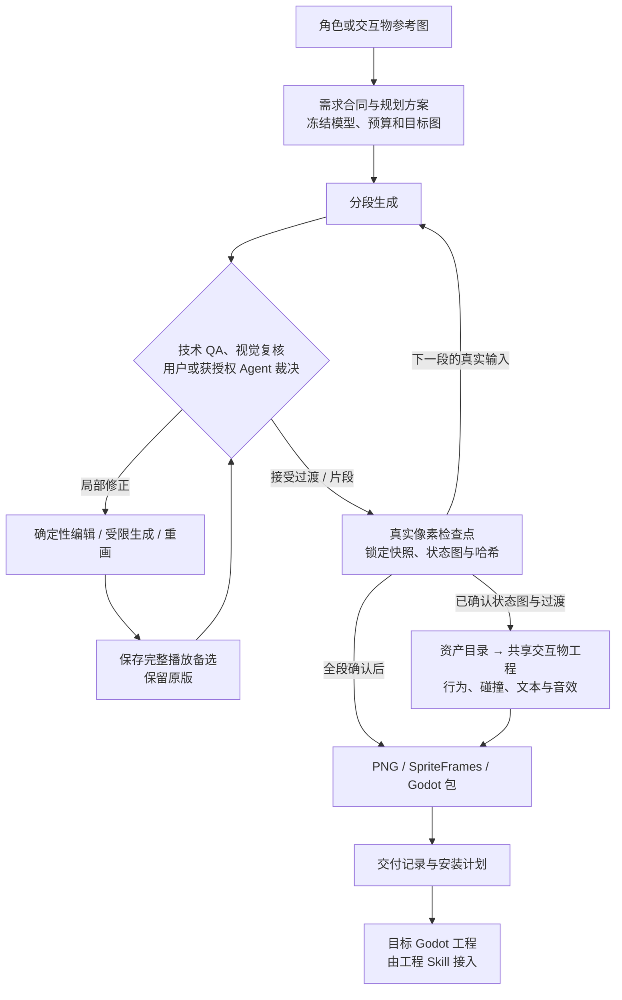

# 系统架构

本文描述 `paper-vbyc` 分支的服务拓扑、模块分层、持久化模型与核心数据流。接口字段与状态细节见[连接器契约](connector-contract.md)，开发测试入口见[开发导航](../workbench/guides/development.md)，工程追踪见[问题清单](问题清单/README.md)。

Forge 是本地优先的 2D 资产制作工作台：Node 负责接入、任务调度、共享编辑与交付；Python SpritePipeline 负责原图、序列帧生产、检查点与备选，并经独立包 `PixelProp` 做物品图像素化转换。本分支保留角色与交互物序列帧、物品原图、图片局部调整、交互物编辑器与 Godot 交付；地图拼接与场景组装归档在 `new-arch` 分支。

## 1. 服务拓扑与调用边界

`npm run dev`（[scripts/dev.mjs](../scripts/dev.mjs)）启动或复用三个本地服务（`npm run dev:interactable` 跳过 SpritePipeline）：

| 服务 | 默认地址 | 职责 |
| --- | --- | --- |
| Web | `http://localhost:3000` | React 19 工作台、Vinext/Vite 与同源代理路由 |
| HTTP Bridge | `http://127.0.0.1:8790` | `scripts/workbench-http.mjs`；任务 API、共享文档、图片会话、资产与交付 |
| SpritePipeline | `http://127.0.0.1:7860` | FastAPI/Uvicorn + Gradio 原生 UI；原图、开放动作、派生素材、检查点与导出（支持 API-only 启动） |

### 调用路径与网络边界

1. **能力任务**：MCP、CLI 与 Bridge 复用 `agent-api`、`task-runtime` 与适配器。
2. **动画原生工作区**：Web 经[开放动作白名单路由](../app/api/workbench/open-motion/route.ts)访问 Python；MCP/CLI 适配器直连同一服务。
3. **共享编辑唯一写入端**：所有共享文档与图片会话请求（含刷新候选读取）均经同一个 Runtime Bridge 执行；Bridge 离线时直接报错，不回退直写文件。同一数据目录仅允许一个写入 Bridge。
4. **本地配对与远端托管边界**：本地 Web/CLI/MCP 先核对 Bridge 健康响应的服务名、协议版本与工作区路径 SHA-256 指纹（远端代理可设 `WORKBENCH_RUNTIME_WORKSPACE_ID`）。远端托管的 Web 页面无法访问开发者本机的回环服务或浏览器存储，远程运行必须独立部署带认证、TLS 与访问控制的 runtime。
5. **Browser WebMCP**：仅在宿主支持 `document.modelContext` 且页面打开时暴露当前页面级工具，不替代仓库级 STDIO MCP。

## 2. 模块分层与注册能力

| 层 | 主要目录 | 职责 |
| --- | --- | --- |
| Agent 指导 | `.agents/skills/`、`workbench/guides/`、MCP discovery | 能力选择、主题路由、制作与工程交接规范 |
| 能力清单 | [workbench/manifest.json](../workbench/manifest.json) | 能力 ID、schema、连接器、页面路由、工作流与目录声明 |
| 接入层 | `scripts/workbench*.mjs`、`app/api/workbench/` | STDIO MCP、CLI、HTTP Bridge 与 Web 同源代理 |
| 共用业务层 | `lib/workbench/agent-api.mjs`、`task-runtime.mjs`、`adapters/` | Agent 操作分派、任务校验持久化与异步恢复 |
| Web 外壳与界面 | `components/workbench/`、`components/ui/`、`app/`、`features/` | 统一顶栏与首页、交互状态、主题同步、图形编辑与预览（页面细节见[界面说明](workbench-interface.md)） |
| 动画生产层 | `Tools/SpritePipeline/sprite_pipeline/`（开放动作在 `collaboration/`） | 对象预设、规划编译、生成、QA、复核、检查点、修正与导出 |
| 像素化工具 | `Tools/PixelProp/`（独立包 `forge-pixel-prop`） | 确定性 64/128 px 像素化转换、配方哈希与对比图 |
| 共享编辑与交付 | `lib/workbench/editor-documents.mjs`、`image-edits.mjs`、`asset-*.mjs`、`game-export.mjs` | 文档事务、图片会话、资产目录、回收站与 Godot 交付 |

`workbench/manifest.json` 注册 4 项 `local-adapter` 能力（由 [adapters/index.mjs](../lib/workbench/adapters/index.mjs) 绑定）；交互物动画面板 `interactable-motion` 登记在 `editorModules` 中，共用 `sprite-generator` 作品数据。共享文档、图片会话、资产与交付则通过各自的类型化 `*-contract.mjs` 与 `agentRequest` 暴露（完整工具表见[工具与任务语义](agent-client-tools.md)）。

- `reference-art`：PixelLab 角色/物品原图生成、本地 PNG 导入、PixelProp 转换与对象移送。
- `sprite-generator`：角色与交互物开放动作规划、生成、检查、修改与导出。
- `image-assets`：GPT Image 透明物品生成、蒙版 AI 编辑与本地图像处理。
- `interactable-editor`：交互物项目校验与 Godot 资源包本地导出（字段由 `features/interactable-editor/contract.mjs` 经 `npm run schema:interactable` 同步至 manifest）。

## 3. 数据与持久化模型

核心生产记录持久化在文件系统，未提交编辑草稿存在浏览器 IndexedDB：

| 数据对象 | 含义 | 默认位置 |
| --- | --- | --- |
| runtime Task（`taskId`） | 一次工作台能力调用、回执与声明产物 | `work/tasks/<task-id>.json`，产物在 `outputs/<task-id>/` |
| 动画 Work（`workId` + revision） | 原始需求、参考快照、冻结规划与作品版本 | `work/sprite-pipeline/open-motion/` |
| 原生 Job（`jobId`） | 候选、真实帧、技术 QA、复核与检查点 | `work/sprite-pipeline/jobs/` |
| 交互物 Document（`documentId` + revision） | 已提交共享工程与不可变历史快照 | `work/editor-documents/` |
| 图片 Session（`editId` + revision） | 源图、区域、属性计划、候选、复核与采用 | `work/image-edits/` |
| 浏览器 Draft | 未提交本地编辑与笔划恢复副本 | IndexedDB `workbench-production-v1` |
| 导入、回收站与交付 | 素材包收件、可见性索引、安装计划与证据 | `work/imported-assets/`、`work/asset-package-imports/`、`work/asset-trash/`、`work/game-exports/` |

> 独立启动 SpritePipeline 时默认使用系统用户数据目录（由 `SPRITE_PIPELINE_DATA_DIR` / `SPRITE_PIPELINE_HOME` 控制）；`npm run dev` 启动器将其指向仓库 `work/sprite-pipeline/` 与 `outputs/sprite-pipeline/`。

任务生命周期状态（`prepared` / `running` / `awaiting_configuration` / `attention_required` / `completed` / `failed`）、摘要缓存 `.summaries-v1/` 及历史分页契约详见[连接器契约](connector-contract.md#2-公共任务模型)。

## 4. 核心生产与交付数据流

各子系统职责与专题文档：

- **原图与对象预设**（[角色原图](reference-art.md) · [物品原图](prop-art.md)）：`reference-art` 与 `object_identity.py` 统一管理 `character` 与 `interactable` 对象；物品原图支持 PixelLab 生成、128×128 导入与 `PixelProp` 转换三种来源并在 `provenance.json` 记录来源摘要。
- **开放动作、检查点与选帧修正**（[序列帧生成](sprite-generator.md) · [选帧调整](motion-adjustments.md) · [视觉复核](sprite-review-evaluation.md)）：`contracts.py`、`workspace.py`、`job_execution.py`、`candidate_artifacts.py` 与 `checkpoints.py` 管理冻结规划、异步执行恢复、多视角复核、交互物状态链与外部目标图；`local_frame_edits.py` 与 `adjustments.py` 负责确定性及生成式备选。
- **共用模型配置**：Python `model_config.py`（`open_motion_models.json`）统一维护各角色模型，Node 经 `motion-vision-profile.mjs` 与 OS 受保护凭据共享读取，用于图片部件定位与独立候选复核。
- **静态图生成与局部调整**（[图片局部调整](image-editing.md)）：`image-edits.mjs` 统一管理交互物静态槽、独立图片任务与 `motion-frame` 三类目标，复用无 DOM 像素核心提供本地工具，并以冻结快照支持原尺寸 `ai-edit` 与 `recompose-ai`。
- **交互物共享文档与独立面板**（[交互物编辑器](interactable-editor.md) · [交互物动画面板](交互物动画独立面板方案.md) · [内部素材导入](internal-imports.md)）：Bridge 管理带 `expectedRevision` 与 `commandId` 的原子事务，支持事件模拟、`import-motion-asset` 槽位写回与 `/tools/interactable-motion` 专用工具及派生素材。
- **资产目录、素材包与 Godot 交付**（[资产目录](asset-catalog.md) · [素材包导入](asset-packages.md) · [Godot 交付](godot-delivery.md) · [游戏工程](game-engineering.md)）：聚合任务产物、原生候选、状态图/派生素材与导入包，提供独立回收站与带备份锁的 Godot 交付管线。
- **预览跟随**（[预览与页面跟随](agent-preview-follow.md)）：`workbench_present` 经 Bridge 心跳通道在原标签切换视图。
- **可选视觉结构与离线实验**（[角色视觉结构](visual-structures.md) · [序列帧实验支撑](motion-experiments.md)）：`Tools/VisualStructure/worker.py` 在独立环境提供 SAM 2.1 分割追踪；`collaboration/experiment.py` 提供冻结协议、对照组回放、客观漂移导出与盲评打包。

## 5. 安全边界与扩展原则

- **凭据隔离**：密钥仅存于环境变量或 OS 受保护存储，不回显到页面，不写入任务、产物或日志。
- **受控代理与路径校验**：Bridge 与默认 Python 监听回环地址；Web 代理严格按路径与方法白名单转发；所有读取、上传、产物与安装路径均校验位于受控目录内并核对哈希。
- **幂等与版本保护**：跨层写入必须带来源 ID、当前 `revision`/`hash` 与稳定 `commandId`；未知付费提交先查回执恢复，不换 ID 重发。
- **单一实现**：扩展能力时分别维护适配器、manifest 与对应契约，不把业务规则复制散落在 Web、MCP、CLI 与 Python 之间。
