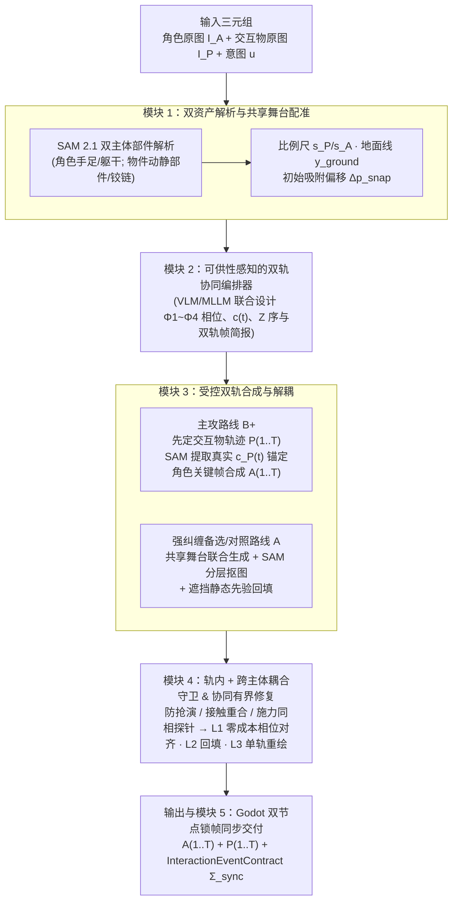

# 暂定论文大纲：以交互事件为单位的角色与交互物协同序列帧生成

> 状态：**2026-11-28 暂定蓝图（`paper-v2` 分支探索起点）**。本分支保留 Forge 既有工程底座与全部技术文档，开启面向**角色—交互物协同动画生成**的新论文主线；原单主体长动作门控论文 *Verify Before You Chain (VBYC)* 已封版归档于 `paper-vbyc` 分支。

- **暂定中文题名**：**《以交互事件为单位：面向 2D 游戏的角色与交互物协同序列帧生成》**
- **暂定英文题名备选**：
  1. *One Event, Two Sprites: Event-Centric Joint Choreography and Coupled Generation for 2D Character–Interactable Animation*
  2. *Choreographing Interaction Events: Coordinated Dual-Track Sprite Animation for 2D Characters and Interactable Props*
- **核心一句话定义**：
  > **“以一次交互事件为单位来生成动画。用户说一句‘角色推开门’，系统就围绕这一次推门，同时设计人物和门各自该怎么动，输出两套已经配合好的序列帧。”**

---

## 1. 问题背景与范式转换：为什么要“事件为中心、双轨为输出”？

在 2D 动作、RPG 与解谜游戏中，玩家与世界交互的生动感高度依赖角色动作与场景物件响应之间的精确咬合（如推门时手掌刚好推在门板边缘并随门扇旋转推进、拉杆随手臂发力同步扳下、蹲下掀箱时箱盖在触碰瞬间弹开）。然而，现有 AI 资产工作流与视频生成模型存在结构性的范式错位：

| 维度 | 传统单资产孤立生成（含现有独立角色/交互物流程） | 通用视频 HOI 单画布联合生成 | **本文新范式：事件为中心、双轨协同输出** |
| --- | --- | --- | --- |
| **生成单位** | 单个资产动作（“角色推”与“门开”各自生成） | 单一固定视口视频画布（人和门像素揉在同一层） | **单次交互事件** $\mathcal{E}=(I_A, I_P, u)$ |
| **规划逻辑** | 互不知晓对方尺寸、铰链、站位与节奏 | 无显式双向运动学规划，靠像素扩散自发共现 | **围绕该事件同时协同设计角色与物件动作** |
| **输出形式** | 两套互不对齐的序列帧 | 一段不可拆分的单层 RGB 视频 | **两套已配合好的透明序列帧 + 同步契约** |
| **空间配准** | 手伸空处或手肘穿模进门板 | 画面内视觉对齐，但像素粘连不可拆层 | 共享交互舞台对齐，落回各自原生坐标系 |
| **因果与节奏** | 手未触及门已先开，或施力/阻力感矛盾 | 全局自由生成，偶有提前形变与结构漂移 | 四阶段因果时间锁死，施力与阻尼感互为约束 |
| **引擎可接入性** | 高（独立节点），但需人工逐帧重画修对齐 | **极低**：无法挂入独立节点/碰撞体/状态记忆 | **开箱即用**：直接驱动双节点锁帧与状态落定 |

### 立论双靶子（Problem Gap）

1. **单资产孤立生成导致“组合失配”**：即便单看角色序列帧和交互物序列帧各自质量都达标，由于生成时不知道对方的相对身高比例、接触点高度、铰链枢轴位置、开合方向（内推/外拉）与重量阻尼，放进游戏引擎拼接时必然出现三大失配——**空间脱靶与穿模**（手推空气、手穿门框）、**因果错拍**（抢演或延迟响应）以及**施力语义矛盾**（轻触配重物缓慢挪动，或发力方向与物体运动轨迹反相）。
2. **单画布视频联合生成破坏“引擎实体隔离”**：近年来人—物交互（HOI）生成常直接在单一像素画布中渲染完整交互视频。但在 2D 游戏运行时（如 Godot 的 `CharacterBody2D` + `WorkbenchInteractable2D`），角色和门必须是**两个生命周期解耦的独立节点**：交互门开启后需持久停留在敞开状态并撤除门板碰撞体让玩家通行，角色则在动作收尾后立刻恢复自由移动与键盘状态机；同时角色走近与离开时需动态切换前后遮挡（Y-sort / Z-index）。被烘焙在单层背景里的视频帧在游戏工程上几乎不可用。

**本文核心洞察**：把 **“规划思考的单位”** 与 **“最终交付的资产单位”** 拆开对齐引擎规律——**在规划与验证阶段，以一次交互事件为单位把人、物放进同一张舞台同频编排；在生成与交付阶段，输出两套各自干净、透明底、时间对齐、接触吻合的独立序列帧与同步契约。**

---

## 2. 问题形式化定义与交互事件分类学

### 2.1 输入、中间编排表示与输出

- **输入事件三元组** $\mathcal{E} = (I_A, I_P, u)$：
  - $I_A$：角色透明参考原图（含朝向 `facing`、视觉部件结构 $\mathcal{V}_A$ 与特征保持约束）；
  - $I_P$：交互物透明参考原图（处于初态 $S_0$，含可动/固定部件结构 $\mathcal{V}_P = \mathcal{V}_P^{\text{moving}} \cup \mathcal{V}_P^{\text{fixed}}$ 与可选铰接枢轴 `hinge`）；
  - $u$：自然语言交互意图，例如 *“角色用力推开沉重的木门”*、*“角色向前扳动墙上的拉杆”*、*“角色蹲下掀开宝箱”*、*“角色弯腰捡起地上的火把”*。

- **中间联合表示——事件编排图谱** $\Pi(\mathcal{E})$：
  1. **共享交互舞台** $\mathcal{S} = (s_P/s_A,\, y_{\text{ground}},\, \Delta \mathbf{p}_{\text{snap}},\, z(1..T))$：确定角色与物件的相对像素比例尺、统一地面接触基线、交互启动瞬间角色相对物件锚点的吸附偏移 $\Delta \mathbf{p}_{\text{snap}} = (x_P - x_A, y_P - y_A)$，以及逐帧/分相位的图层遮挡次序 $z(t) \in \{\text{actor\_front}, \text{prop\_front}\}$。
  2. **施力端—可供性部件配对** $(e, a)$：从角色部件集挑选施力部位 $e \in \mathcal{V}_A$（手部、双臂、脚、持握道具等），绑定至交互物可动受力区 $a \in \mathcal{V}_P^{\text{moving}}$（门把手、推门区、拉杆握柄、箱盖前沿），同时显式锁定静止锚定区 $\mathcal{V}_P^{\text{fixed}}$（门框、基座、地砖框）。
  3. **双向约束的四阶段因果时间轴** $(1..T)$：
     - **阶段 $\Phi_1$：趋近与蓄力（Approach / Wind-up, $[1, t_{\text{engage}})$）**：角色重心移动、手臂/脚部伸向 $\mathbf{c}(t_{\text{engage}})$ 并体现发力前摇；**因果硬约束**：交互物严格维持 $S_0$（零像素位移）。
     - **阶段 $\Phi_2$：接触建立（Engage, $t = t_{\text{engage}}$）**：施力端与可供性区在共享舞台坐标系中实现空间重合（距离 $\le \tau_{\text{contact}}$）。
     - **阶段 $\Phi_3$：耦合施力与协同演化（Coupled Co-Motion, $[t_{\text{engage}}, t_{\text{release}}]$）**：沿规划模型协同设计的共享接触轨迹 $\mathbf{c}(t)$ 与施力矢量 $\vec{f}(t)$，角色姿态前倾/跟进与交互物旋转/平推/形变同步行进；**双向互锁**：物件重量与轨迹决定角色借力步幅与躯干倾角，用户描述的发力动作（“轻推”vs“猛踹”）同时决定交互物启动加速度与打开速度。
     - **阶段 $\Phi_4$：脱离与状态落定（Release & Settle, $(t_{\text{release}}, T]$）**：角色收回施力端并稳定收尾至可无缝切回 `idle` 的自然站姿；交互物完成惯性余振并稳定落入终态 $S_1$。

- **输出协同资产包** $\mathcal{O} = (A_{1..T},\, P_{1..T},\, \Sigma_{\text{sync}})$：
  - $A_{1..T}$：角色透明背景序列帧（保留完整角色画幅与独立动作周期）；
  - $P_{1..T}$：交互物透明背景序列帧（与 $A_{1..T}$ 帧率一致、关键相位帧号严格对齐）；
  - $\Sigma_{\text{sync}}$：机器可执行的交互同步契约 JSON（供工作台预览与 Godot 运行时直接绑定）。

### 2.2 面向 2D 游戏的三大交互事件原型

围绕 Forge 交互物行为类型（`toggle` / `sequence` / `pickup` / `inspect`），本框架覆盖三类具有代表性的双轨结构：

| 事件原型 | 典型示例 | 双轨生命周期与状态特征 | 对 Forge 交互物类型的映射 |
| --- | --- | --- | --- |
| **Type I：刚体/铰接持续操控** | 推拉木门、扳动拉杆、掀开宝箱、推石碑 | 接触期内双轨共轨推进；结束时角色回正，物件从 $S_0 \to S_1$ 持久驻留并更新碰撞体 | `toggle`（双态切换） / `sequence` |
| **Type II：瞬时触发反馈交互** | 拍下按钮开关、敲响机关钟、挥杖点燃火盆 | 在 $t_{\text{engage}}$ 建立瞬时接触冲击，此后角色先撤手，物件进入 $\Phi_3\text{–}\Phi_4$ 独立反应与落定动画 | `toggle` / `inspect` / `sequence` |
| **Type III：跨轨所有权转移（拾取/放置）** | 弯腰捡起地面火把、将钥匙插入锁孔 | 在交接帧 $t_{\text{transfer}}$ 触发所有权跃迁：$t < t_{\text{transfer}}$ 物体位于 $P$ 轨，$t \ge t_{\text{transfer}}$ $P$ 轨消隐/退回空底座且物体并入角色手部持握姿态 | `pickup`（拾取） / 装备切换 |

---

## 3. 系统方法架构蓝图（五大核心模块）

### 3.1 模块一：异构双资产空间配准与共享舞台构建（Spatial & Scale Registration）

单独生成的角色图（如 PixelLab `128×128`）与物品图（`128×128` 或 `PixelProp` 转换图）往往都做过居中满画幅缩放，直接叠放在一起常出现“宝箱与人物同高”或“门浮在脚底上方”的尺度失调。模块一完成：
1. **双端视觉结构解析**：复用并扩展 SAM 2.1 + VLM 解析能力，分别标注角色的可控施力端/脚底基线与交互物的可动部件、固定底座与铰接轴心。
2. **语义—几何联合配准**：VLM 依据交互语义 $u$ 与部件比例给出初始尺度比 $s_P / s_A$（并做整数倍/像素网格友好约束）、共同地面基线 $y_{\text{ground}}$ 与交互起点相对位置 $\Delta \mathbf{p}_{\text{snap}}$；生成“双主体共享舞台静态预览合成图”供人工一眼核验相对站位与大小是否合理。

### 3.2 模块二：可供性感知的事件级双轨编排规划器（Affordance-Grounded Event Choreographer）

这是“**围绕一次交互事件同时设计人怎么动、门怎么动**”的核心大脑：
- **输入**：共享舞台静态合成图、双方已核对部件掩码与轴心标注、用户一句交互描述 $u$。
- **双向协同规划输出（`InteractionEventPlan`）**：
  1. **事件相位时间轴**：总帧数 $T$、帧率 `fps`、接触建立帧 $t_{\text{engage}}$、接触脱离/状态转折帧 $t_{\text{release}}$（或所有权交接帧 $t_{\text{transfer}}$）；
  2. **逐关键帧耦合运动路标**：每个关键帧（至少涵盖 $\Phi_1$ 起点、$t_{\text{engage}}$、$\Phi_3$ 中点、$t_{\text{release}}$、$\Phi_4$ 终点）的共享接触坐标 $\mathbf{c}(t)$、施力方向矢量 $\vec{f}(t)$、前后遮挡次序 $z(t)$ 以及交互物运动比例曲线 $q(t) \in [0, 1]$（如“前 2 帧阻力大开合慢，后 3 帧推开加快”）；
  3. **联合编译出的双轨动作约束与绘图简报**：在规划阶段即保证角色伸手高度与门把手一致、发力步幅与推门幅度匹配、收尾姿态回落到安全中立位，随后编译生成分别驱动交互物轨与角色轨的结构化绘图简报。

### 3.3 模块三：受控双轨序列帧合成与图层解耦（正面突破黑盒生成器局限）

鉴于当前常用像素序列帧生成接口（如 `PixelLab` 限 `64×64`/`128×128` 单主体参考加文本/端点引导，暂不开放原生骨骼或密集光流控制通道），大纲显式规划**两条渐进路线 + 一条开放后端探索路线**，并通过先导实验比对选出主力方案：

- **主力优先路线 B+：运动学主导的主从耦合合成（Kinematics-Guided Coupled Synthesis）**
  - **流程**：① 先按联合规划 `InteractionEventPlan` 中的交互物部分合出（或结合铰链几何草稿求解）交互物轨 $P_{1..T}$，并用 `T1` 固定部件回填与 `T3` 对齐锁定门框/底座；② 用 SAM 2.1 对 $P_{1..T}$ 做跨帧分割追踪，抽取出交互物在像素画面中的**真实可供性受力点轨迹 $\hat{\mathbf{c}}_P(1..T)$**（消除理想规划与真实抽帧之间的微小误差）；③ 依据 $\hat{\mathbf{c}}_P(t_{\text{engage}}), \hat{\mathbf{c}}_P(t_{\text{mid}}), \hat{\mathbf{c}}_P(t_{\text{release}})$ 与 $\Delta \mathbf{p}_{\text{snap}}$，将受力目标在共享舞台换算回角色局部坐标系，生成角色关键接触引导草稿（视觉锚定端点或分阶段合成参考）以引导分段生成角色轨 $A_{1..T}$。
  - **优势**：**天然分离双层透明通道**——不存在“人挡住门后如何抠图并无痕补洞”的棘手瑕疵，且人物与物件各自独占完整的 `128×128` 像素分辨率预算。

- **备选与对照路线 A：共享舞台联合生成 + SAM 时序分层 + 遮挡先验回填（Joint-Stage Synthesis & Layered Matting）**
  - **流程**：在共享舞台画布上拼合 $I_A$ 与 $I_P$ 后，围绕接触核心窗口做联合生成，迫使生成器在同一画面下给出紧密贴合的交互姿态与物理接触；随后使用 SAM 2.1 双提示跨帧追踪将画面分割拆回 $A_{1..T}$ 与 $P_{1..T}$，并利用交互物未遮挡初态 $S_0$、终态 $S_1$ 与邻近未遮挡帧作为结构先验，回填交互物上曾被角色手臂/躯干遮住的区域。
  - **定位**：作为强身体纠缠交互（如扛起箱子、穿过正在合拢的大门）的补充方案，并与路线 B+ 在实验中正面对比分辨率损耗、遮挡补洞伪影与接触紧密度。

- **上限探索路线 C：可控视频/扩散后端 + 确定性像素化（Trajectory-Conditioned Backend + `PixelProp`）**
  - 将编排器输出的逐帧接触轨迹与部件锚框输入支持轨迹/姿态条件的开放权重模型，生成连续运动后经 Forge 自研 `PixelProp` 做确定性网格下采样与色板锁色。该路线用于评估是否必须依赖外部可控开放扩散模型才能完成大角度透视交互。

### 3.4 模块四：轨内与跨主体耦合守卫 + 双轨协同有界修复

在保留 Forge 已有**单主体轨内确定性探针**（角色：地面基线偏移、前景面积变化、色板偏离、质心跳变；交互物：固定部件像素变化、2D 铰接杆长/半径守恒）基础上，构建三项专门针对“两个人/物配合关系”的**跨轨耦合探针（Cross-Track Coupling Probes）**与对应修复阶梯：

1. **因果防抢演探针（Causal Non-Anticipation Probe）**：
   $$\max_{1 \le t < t_{\text{engage}}} \Delta_{\text{part}}\big(\mathcal{M}_{\text{moving}}(P_t), \mathcal{M}_{\text{moving}}(P_1)\big) \le \tau_{\text{static}}$$
   专治“角色手还没伸出去，门自己先悄悄转开”的因果破绽。
2. **接触重合与防滑脱探针（Contact Coincidence & Non-Slippage Probe）**：
   在共享舞台坐标系 $\mathcal{S}$ 中，对所有接触帧 $t \in [t_{\text{engage}}, t_{\text{release}}]$，衡量角色施力端掩码与交互物可供性受力区掩码的最小像素距离：
   $$d_{\min}\big(\mathcal{M}_{\text{effector}}(A_t),\, \mathcal{T}_{\Delta \mathbf{p}_{\text{snap}}, s_P/s_A}(\mathcal{M}_{\text{affordance}}(P_t))\big) \le \tau_{\text{contact}}$$
   专治“隔空推门”“推在空气里”或“接触后手部滑脱门板”。
3. **施力—运动方向同相探针（Directional Coherence Probe）**：
   检测接触期内施力端运动向量与交互物受力部位位移向量之间的余弦方向一致性，拦截“人往右推、门往左缩”的物理反相错误。

- **协同有界修复策略（Coordinated L1–L4 Repair）**：
  - **L1 零成本跨轨时空微调（Phase & Offset Alignment）**：面向最常见的“两套单看都对、但配合差半拍或错位 2–3 像素”问题，无需重调任何图像生成模型，直接执行**确定性帧时间重映射（Phase Warping / 静态首尾抽插或驻留调节）**与吸附偏移 $\Delta \mathbf{p}_{\text{snap}}$ 整数微调，瞬间对齐两轨的 $t_{\text{engage}}$ 与接触位移。
  - **L2 确定性底座保护与遮挡回填**：沿用并扩展 `T1`、`T3` 工具锁定物件不动部分并补齐分割空洞。
  - **L3 单轨接触窗口受控重绘**：若仅有一轨动作错误，**锁定已达标的一轨及对齐轨迹作为强参考条件**，仅对失配轨在 $[t_{\text{engage}}-1, t_{\text{release}}+1]$ 局部窗口执行有界重绘。
  - **L4 重新规划相位或回退工作台人工检查确认**。

### 3.5 模块五：面向 Godot 4.7 的双节点锁帧同步交付（`InteractionEventContract`）

定义机器可读的 **`InteractionEventContract` ($\Sigma_{\text{sync}}$)**，打通资产制作到真机玩法的最后一公里：
- **核心契约字段**：
  - 空间对接：`actor_scale`、`prop_scale`、`snap_offset_px`（交互开始前玩家需要平滑走位对齐的精确相对坐标）、`required_facing`、`z_order_schedule`（按帧指定角色在前或在后）；
  - 双轨帧源与时序：`actor_clip`、`prop_clip`、`fps`、`total_frames`、`engage_frame`、`state_commit_frame`（交互物碰撞体与持久状态正式切换的确切帧）、`release_frame`；
  - 生命周期规则：`actor_post_action`（返回 `idle`）、`prop_end_state`、`ownership_transfer`（若为拾取类事件，记录交接帧号与角色获得状态）。
- **引擎侧运行时闭环（升级既有 `InteractionRuntime2D` / `WorkbenchInteractable2D` 模版）**：
  玩家按下交互键 `E` $\to$ 运行时冻结常规输入并将玩家从当前位置在短平滑时间窗内微调吸附至物件参考点的 $\Delta \mathbf{p}_{\text{snap}}$（或校验交互热点区间） $\to$ 同步锁定双节点 `AnimatedSprite2D` 按同 `fps` 与同一帧计数器步进播放（实时按 `z_order_schedule` 更新绘制层级） $\to$ 在 `state_commit_frame` 精确触发 `interaction_completed` / 碰撞禁用 / 状态持久化 $\to$ 播至末帧后无缝将控制权归还玩家状态机。

---

## 4. 与现有 Forge 项目底座的演进映射（复用 · 改造 · 新建）

`paper-v2` 并非推倒重来，而是站在 Forge 现有工程资产的肩膀上向上生长。下表逐一明确代码资产归属：

| 归属类别 | 现有 Forge 模块 / 能力 | 在 `paper-v2` 中的角色定位与改造方式 |
| --- | --- | --- |
| **直接复用（~50% 基础底座）** | SAM 2.1 原图解析与跨帧追踪（`structures.py`、`tracking.py`、`Tools/VisualStructure/`） | **直接扩展为双端分析**：同时提取角色施力部位（手/足）掩码序列与交互物动/静部件轨迹，用于配准与跨轨探针 |
| **直接复用** | 交互物部件模型与状态骨架（`contracts.py`、`prop_measurements.py`） | 直接承接交互物轨的 `fixed_parts` / `moving_parts` / `hinge` 轴心定义与 `S_0 \to S_1` 状态骨架 |
| **直接复用** | 角色物理稳定性与单帧检查（`character_measurements.py`、`frame_checks.py`） | 保留为角色轨内（Intra-Track）物理守卫（地面基线、体积与色板漂移校验） |
| **直接复用** | 分段检查点、弃权守卫与局部修复工具（`checkpoints.py`、`dispute_review.py`、`local_frame_edits.py`、`adjustments.py`、`T1–T10`） | 检查点状态机扩展支持“双轨并排叠放审核”；`T1–T3` 升级为跨轨遮挡回填与固定底座锁定工具 |
| **直接复用** | 像素化与 Godot 打包交付链路（`Tools/PixelProp/`、`features/godot-export/`、`lib/workbench/game-export.mjs`） | 复用资产转换及标准打包安装器，将协同导出纳入同一安全安装账本与交付校验体系 |
| **改造升级** | `planning.py` 规划格式与编译框架 | 从单一主体分段规划，升级为共享舞台驱动的事件级双轨编排与双向编译输出 |
| **改造升级** | Godot 插件运行时（`features/interactable-editor/godot-templates/interaction_runtime_2d.gd`、`workbench_interactable_2d.gd`） | 新增双节点同帧锁步播放器、吸附移动过渡、动态 Z-order 切换与 `state_commit_frame` 状态落盘 |
| **全新开发 1** | **双资产配准与共享舞台合成器（拟新增 `interaction_stage.py`）** | 负责 $s_P/s_A$ 比例尺计算、地面线对齐、$\Delta \mathbf{p}_{\text{snap}}$ 标定与双层叠加实时合成渲染 |
| **全新开发 2** | **事件级联合编排器与同步契约（拟新增 `event_choreographer.py`）** | 落地 `InteractionEventPlan` 与 `InteractionEventContract` 数据契约，完成 $\Phi_1\text{–}\Phi_4$ 相位及接触路标设计 |
| **全新开发 3** | **双轨耦合合成执行器（拟新增 `coupled_generator.py`）** | 实现路线 B+（交互物轨迹抽提 $\to$ 角色接触关键帧引导合成）与路线 A（联合画布 + 分层回填）对照切换 |
| **全新开发 4** | **跨轨物理探针与相位对齐器（拟新增 `interaction_probes.py`、`phase_aligner.py`）** | 实现防抢演、接触重合距离、施力方向同相三项探针，以及 L1 零成本跨轨时间相位对齐与微移 |
| **全新开发 5** | **工作台「协同交互制作」交互界面（前端新工作区）** | 支持导入/选择一对角色+交互物，输入一句话交互，可视化调节相对站位比例尺，同屏预览双层叠加效果并导出联动包 |

---

## 5. 核心学术创新点提炼与相关工作定位

### 5.1 三条核心学术贡献（Contributions）

1. **新问题定义与生成范式（Event-Centric Plan, Dual-Track Asset Output）**：
   首次针对 2D 游戏研发管线提出“以单次交互事件为最小规划单元、以双套配合序列帧及引擎同步契约为输出单元”的协同动画生成问题形式化。该范式在逻辑层统一求解角色施力与物件响应的因果接触，在表示层维持两套透明序列帧的结构独立性，一举解决“孤立双资产组合必错位”与“视频级 HOI 合并画布进不了引擎”的双重痛点。
2. **可供性感知的双向事件编排与双轨耦合合成机制（Affordance-Grounded Joint Choreography & Coupled Synthesis）**：
   基于双主体结构分割与四阶段因果时间相（$\Phi_1\text{–}\Phi_4$），设计了受物件铰接/可动部件可供性与用户动作语义双向约束的联合规划器；并针对黑盒图像生成器缺乏密集控制通道的现实瓶颈，提出利用交互物运动学轨迹锚定角色接触关键帧的主从耦合合成策略（路线 B+），对比联合画布分层回填策略（路线 A），在保持透明通道纯净度的同时大幅提升近身接触精度。
3. **跨主体因果—接触物理守卫与零成本相位对齐闭环（Cross-Entity Causal/Contact Guards & Phase-Aligned Repair）**：
   提出专门面向双主体交互的确定性耦合探针（因果防抢演、共享舞台接触距离与施力方向同相性）及跨轨协同分级修复闭环；特别是 L1 零生成费用的跨轨相位重映射对齐机制，使大量轻量级“动作对、节奏差一两帧”的双轨作品得以零额外推理成本直接校准入引擎。

### 5.2 相关工作三线对比定位（Related Work）

- **Line A：2D 角色与精灵序列帧生成**：现有研究及商用工具（如 Sprite Diffusion 类方法、PixelLab、乃至本分支此前的单主体长动作方案）均聚焦“单个实体”在空背景下的循环或独立动作生成，缺乏对另一场景实体几何、铰链与碰撞边界的跨资产协同约束。
- **Line B：3D 与通用视频人—物交互生成（HOI）**：如 *HOIGen-1M*、*VHOI*、*HOI-PAGE* 等关注写实视频或 3D SMPL 人体网格与 3D 物体抓取交互。其一，它们假设存在 3D 骨架拓扑或海量真人类动作捕捉视频先验，无法直接迁移至造型各异的 2D 像素游戏角色与门/机关资产；其二，视频 HOI 方法普遍输出不可拆分单画布，缺失面向游戏状态机、前后层调度与持久碰撞切换的双轨交付契约。
- **Line C：游戏交互动画制作与程序化运动**：传统工作流依赖美术师参照静态尺寸表逐对绘制交互动画，或在 3D 引擎中通过运行时 IK 实时拖拽双手骨骼贴靠把手——2D 逐帧精灵（`SpriteFrames`）不存在运行时骨骼供 IK 实时弯折，必须在生成期便完成精准配合。本文以“事件规划 + 双轨帧配合 + 轻量级引擎吸附契约”填补 2D 游戏管线的这一长期空白。

---

## 6. 实验设计与评测体系草案（RQ1–RQ4）

### 6.1 研究问题（Research Questions）

- **RQ1（协同配合质量）**：相比“分别孤立生成后拼合”与“仅共享文本提示词”的方法，事件级联合编排与耦合合成能否显著降低 2D 交互动画的接触像素误差、因果抢演率与发力方向冲突？
- **RQ2（合成路线权衡与模块消融）**：路线 B+（交互物轨迹锚定角色）与路线 A（共享舞台合拍后 SAM 分层回填）在接触紧密度、双主体像素保持率及边缘纯净度上各有什么定量优劣？移除跨轨耦合探针与 L1 相位对齐分别会造成多大退化？
- **RQ3（跨原型泛化能力）**：在铰接持续操控（推门/拉杆）、瞬时脉冲触发（按钮/火盆）与跨轨所有权转移（拾取道具）三类不同物理交互机制下，系统表现是否保持稳健？
- **RQ4（游戏引擎真机可玩性）**：将输出的双轨资产包与同步契约直接接入 Godot 2D 测试关卡后，在实机按 `E` 触发交互的玩法体验与一次性交付通过率上，人类玩家与游戏开发者的盲评结果如何？

### 6.2 基准任务集与对比基线

- **拟构建 2D 交互事件基准集（24–30 组配对测试集）**：
  覆盖多类体型与造型角色（如剑士、法师、矮人/盗贼、非人型史莱姆/机器人）$\times$ 跨三大交互原型代表性事件（`向右推开木门`、`向外拉动生锈拉杆`、`掀开重锁宝箱盖`、`用力踩下石板机关`、`敲击挂铃/点亮火盆`、`弯腰拾取地面火把`），兼顾正侧视图与斜俯视角。
- **五组对比方案（同源原图、同等最大生成预算）**：
  1. `Isolated-Dual`（**孤立双生成基线**）：以同一事件意图分别编译单角色文本与单交互物文本独立生成，按同帧数直接叠放进舞台（代表传统分线制作流程）；
  2. `Prompt-Only Coupled`（**纯文本协同步调基线**）：共享一句话文本与帧长规划，但不传递共享舞台尺度、接触轨迹草图与跨轨探针；
  3. `Route-A (Joint-Matting)`（**同画布联合生成+分层回填对照**）：验证联合生成+SAM 时序分割+静态先验补洞路线；
  4. `Ours w/o Cross-Guard & Phase-Align`（**关键消融组**）：关闭因果防抢演探针、接触距离探针及 L1 跨轨相位对齐；
  5. `Ours (Full Event-Centric Dual-Track)`（**完整方法**）。

### 6.3 客观指标与真机盲评体系

| 评测维度 | 具体指标 | 定义与测量方式（全部支持离线确定性计算或真机录制） |
| --- | --- | --- |
| **空间接触精准度** | **Contact Pixel Error (CPE $\downarrow$)** | 在接触区间 $[t_{\text{engage}}, t_{\text{release}}]$ 内，角色施力端掩码与交互物可供性掩码在共享舞台下的平均/最大最小像素距离；低于阈值 $\tau_{\text{contact}}$ 记为接触命中率 `Contact Hit Rate` $\uparrow$ |
| **因果时序正确性** | **Premature Activation Rate (PAR $\downarrow$)** | 在 $t < t_{\text{engage}}$ 区间内交互物可动部件提前发生显著像素位移的样本比例（识别“隔空抢演”） |
| **双轨节奏同步度** | **Engage Timing Offset ($|\Delta t_{\text{engage}}|$ $\downarrow$)** | 角色实际到达交互接触位置帧与交互物可动部件真实启动运动帧之间的帧号偏差 |
| **施力物理合理性** | **Directional Coherence ($\uparrow$)** | 接触窗口内施力端位移矢量与物体受力运动矢量的余弦相似度均值 |
| **实体独立保真度** | **Dual Identity & Alpha Purity ($\uparrow$)** | 角色色板/前景面积漂移、交互物固定底座 IoU/像素不变率，以及双层独立背景下的边缘色彩污染率 |
| **引擎实机盲评** | **Godot Playability & Plausibility** | 将全部组别匿名打包导入同一 Godot 2D 测试房，受试者亲自操控角色走近按键交互，按 5 分制盲评**接触可信度、施力重量感、画风融合度、进出状态过渡自然度**及首选排序 |

---

## 7. 暂定论文章节规划（8–10 页蓝图）

（依据后续先导实验结果与拟投目标会议/期刊规范在 8 页双栏与 10 页之间弹性落定）

| 章节 | 预计篇幅 | 核心内容与必出图表 |
| --- | --- | --- |
| **1. Introduction** | ~1.2 页 | 切入 2D 游戏双节点隔离现实矛盾（孤立生成错位 vs 视频 HOI 进不了引擎），提出“事件为中心、双轨为输出”；**图 1（Teaser）**：输入一句话“角色推开门”与两张静图 $\to$ 协同编排舞台 $\to$ 输出人与门双套透明序列帧并在 Godot 实机推开通过（附孤立生成失败缩略对照）。 |
| **2. Related Work** | ~0.9 页 | 2D 精灵与序列帧生成、视频/3D HOI 交互生成、游戏运行时交互与程序化动画三条线清晰对比表格。 |
| **3. Problem Formulation** | ~0.8 页 | 正式给出事件三元组 $\mathcal{E}=(I_A, I_P, u)$、共享舞台 $\mathcal{S}$、四阶段因果时间轴（$\Phi_1\text{–}\Phi_4$）、三大事件原型及输出契约 $\Sigma_{\text{sync}}$。 |
| **4. Method** | ~2.5 页 | **图 2（系统全链路架构图）**；详述五大模块：双端解析配准、联合事件编排器、受控双轨合成路线 B+/A、跨主体物理探针（防抢演/接触距离/同相性）与 L1 相位对齐修复、Godot 同步契约交付。 |
| **5. Benchmark & Implementation** | ~0.8 页 | 24–30 组配对事件数据集构成、共享舞台及跨轨探针实现阈值设置、对比基线对齐预算口径。 |
| **6. Experiments & Quantitative Results** | ~1.8 页 | 回答 RQ1–RQ3：定量对比主表（CPE、PAR、$|\Delta t_{\text{engage}}|$、物理一致率、保真度）、路线 B+ vs A 定量定性权衡、消融实验柱状图与典型案例逐帧分解对比图。 |
| **7. In-Engine Integration & User Study** | ~0.8 页 | 回答 RQ4：Godot 实机触发交互耗时/成功接入统计、用户亲自试玩交互关卡盲评结果与典型操作序列。 |
| **8. Limitations & Conclusion** | ~0.5 页 | 坦诚讨论强遮挡全身穿行（如钻石门洞深处侧身穿过）、极端视角透视变换及多角色同时交互同一物件的边界与未来工作。 |

---

## 8. 风险清单与第一阶段可行性先导实验（2–3 天 Spike 路线）

在投入大规模前后端工程与全量基准跑测前，先执行最小可行性验证（Minimum Viable Spike），用真机画面与定量样本验证核心假设是否成立：

### 8.1 核心技术风险预判
1. **黑盒序列帧后端可控性边界**：当前生成接口无原生骨骼通道，若仅用交互物真实轨迹合成关键帧草稿，PixelLab 等模型在强动态动作下对关键帧空间位置的服从度到底有多高？（这是**头号技术风险**）。
2. **异构画风融合门槛**：玩家自绘角色与不同画风的交互物原图在像素粗细（pixel density）、描边深浅与光照角度不一时，即便时空完美对齐，实机同框仍会显假。
3. **SAM 2.1 对极小受击区域（如 6×6 px 门把手、指尖像素）的追踪鲁棒性**：当手部快速挥动发生动态变形时，施力端与可供性区边界点容易跟丢，需要辅以形态学/质心回退策略。

### 8.2 Spike 验证行动清单（不改主体工程，用隔离脚本先跑 2–4 对真实事件）

1. **锁定 2 对高辨识度先导事件**：
   - 事件 1（Type I 铰接操控）：`骑士向右推开木门`（检验手—把手接触追踪、因果不抢演与开后通行状态）；
   - 事件 2（Type III 或开合操控）：`法师打开宝箱` / `捡起地上火把`（检验蹲身/俯身比例配准、盖子遮挡或所有权转移）。
2. **三项必验指标通过门禁**：
   - **实验 A（编排可行性）**：VLM 基于双原图 SAM 结构标注，能否稳定产出合理比例尺 $s_P/s_A$、吸附站位偏移 $\Delta \mathbf{p}_{\text{snap}}$ 与四阶段接触轨迹 $\mathbf{c}(t)$？
   - **实验 B（路线 B+ vs 路线 A 正面 PK）**：同画布生成再抠图（路线 A）与先固物件轨迹再锚定引导角色（路线 B+），在现有真实后端上哪种方案产出的双层透明帧穿帮率更低、可修复率更高？
   - **实验 C（L1 零成本对齐验证）**：对生成存在 1–2 帧抢演或延迟的原始双轨样片，施加 L1 相位重映射与偏移微调，验证 `CPE` 与 `PAR` 的实际改善幅度，并在 Godot 空白房间中跑通双节点按键实机联动 demo。
3. **决策出口**：Spike 完成并确认主力合成路线（B+ / A / 混合开关）与生成器适配能力后，再正式冻结 `paper-v2` 方法细节并进入工程模块开发与完整基准测试。
